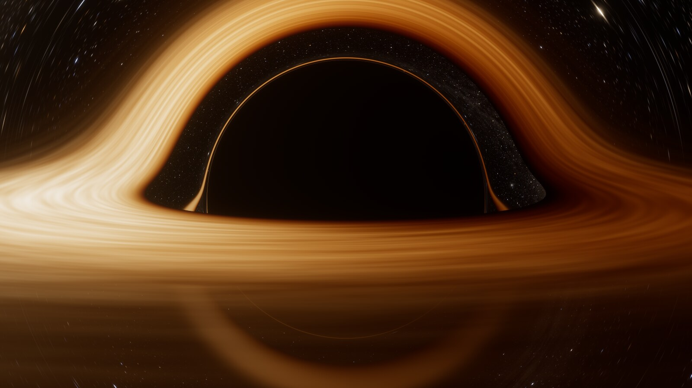
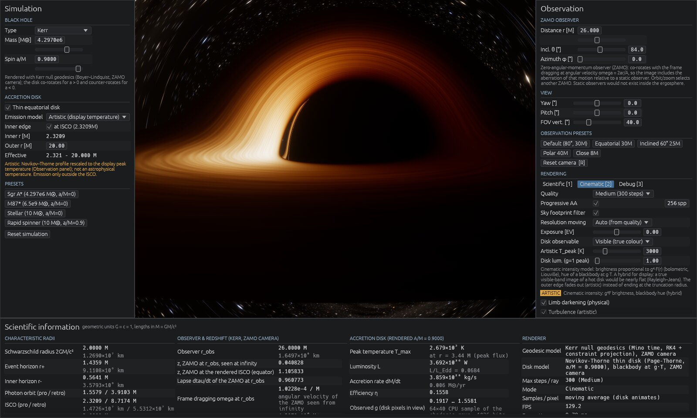
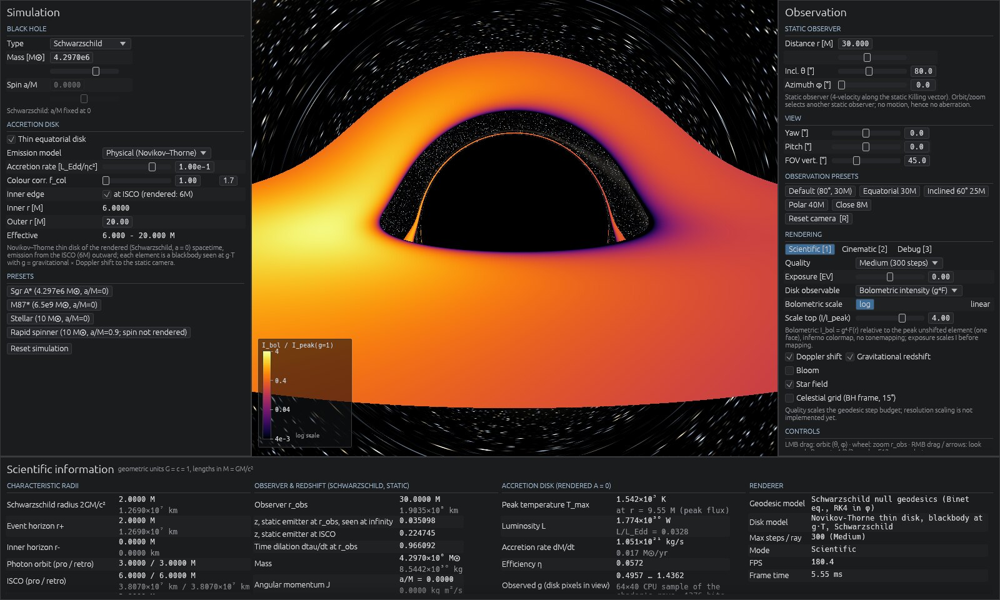
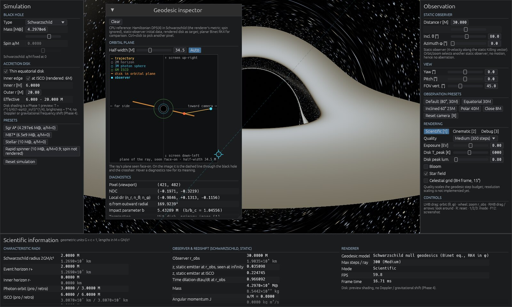

<p align="center"></p>

<h1 align="center">Kerr</h1>

<p align="center"><b>Real-time relativistic ray tracing of black holes, for the desktop.</b><br>
Linux and Windows · free · <a href="https://github.com/martinezmarcos/kerr-releases/releases/latest">Download the latest version</a></p>

Kerr follows the path of light around a black hole on the GPU, one ray per pixel, using
Einstein's general relativity. The dark shadow, the thin photon ring, the far side of the disk
bent over the top and the distorted stars behind it are not drawn by hand: they come out of the
physics.

<p align="center"></p>

## What you can do

- **Spin the black hole.** Go from a non-rotating (Schwarzschild) hole to a rapidly spinning
  (Kerr) one and watch the shadow flatten on one side and the disk move inward as space itself is
  dragged around.
- **See relativity at work.** The side of the disk moving toward you is blueshifted and many
  times brighter than the side moving away. Scientific mode shows it quantitatively, with a
  colour bar; Cinematic mode makes it look like a film shot (and labels what is artistic).
- **Fly around it.** Orbit, zoom and look around with the mouse, or put the camera in orbit or
  in free fall to see the sky aberrated and Doppler-shifted.
- **Follow a single ray.** Ctrl + click any pixel to trace that ray of light and see its path
  around the hole, with the numbers behind it.
- **Use a real sky.** Swap the generated star field for NASA's Gaia star map, or any HDR image.
- **Real numbers.** Horizon size, photon orbit, innermost stable orbit, disk temperature and
  luminosity for Sgr A\*, M87\* or any mass and spin you choose.

<table>
<tr>
<td width="50%"></td>
<td width="50%"></td>
</tr>
<tr>
<td>Scientific mode: the side of the disk coming toward you is about 47 times brighter than the side moving away.</td>
<td>Ctrl + click a pixel to trace its ray of light and see where it came from.</td>
</tr>
</table>

Under the hood: Rust, the Bevy engine and WGSL shaders. The renderer is checked against two
independent high-precision CPU integrators, ray by ray, on the GPU itself.

## Install on Linux (x86_64)

Requirements: a GPU with a Vulkan driver (`vulkaninfo` should list it), Wayland or X11.

Download `black-hole-lab-<version>-x86_64-linux.tar.gz` from
[the latest release](https://github.com/martinezmarcos/kerr-releases/releases/latest), then:

```sh
tar xzf black-hole-lab-<version>-x86_64-linux.tar.gz
cd black-hole-lab-<version>-x86_64-linux
./install.sh            # for your user; then open "Kerr" from the application launcher
```

System-wide: `sudo ./install.sh --prefix /usr/local`. Uninstall: `./install.sh --uninstall`.

## Run on Windows (10/11, 64-bit)

Requirements: a GPU with DirectX 12 or Vulkan and an up-to-date graphics driver.

Download `Kerr-<version>-windows-x64.exe` from
[the latest release](https://github.com/martinezmarcos/kerr-releases/releases/latest) and
double-click it. It is a single portable file: nothing to install, and it can live in any
folder. The `…-x86_64-windows.zip` holds the same exe plus a README.

The exe is not code-signed, so the first time Windows SmartScreen says it "protected your PC":
choose **More info › Run anyway**. Settings and scenes are kept in `%APPDATA%\black-hole-lab\`
and screenshots (F12) in `Pictures\Kerr\`. To uninstall, delete the exe and those folders.

## First steps

Press **F1** in the app for every shortcut. The essentials:

| Input | Action |
|---|---|
| Left drag | Orbit around the hole |
| Mouse wheel | Move closer or farther |
| `1` / `2` / `3` | Scientific / Cinematic / Debug |
| `Ctrl` + click | Trace the ray of light of that pixel |
| `H` | Hide the panels |
| `F12` | Save a screenshot |

## Updates

Kerr checks this page for a newer version when it starts (you can turn that off in
F1 › About). Your settings and saved scenes are always kept.

- **Linux:** click **Update now** in the notice. Kerr downloads the new version, checks its
  signature, installs it and restarts. This works for copies installed with `./install.sh`;
  otherwise download the new archive and run `./install.sh` again.
- **Windows:** the notice links to the new download. Replace the old exe with the new one.

Every Linux archive is signed with [minisign](https://jedisct1.github.io/minisign/). The app
refuses an update whose signature does not match. To check a download by hand:

```sh
minisign -Vm black-hole-lab-<version>-x86_64-linux.tar.gz \
  -P RWT6ZoBdfcMRrNUGGUJ1xd1t/YxpV2pqc5BghoDvUi+lHd42D3WZcT8s
```

## Problems and feedback

Found a bug or have an idea? [Open an issue](https://github.com/martinezmarcos/kerr-releases/issues).
For a bug, include your system (Linux distribution or Windows version), your GPU and what you
did. If the app does not start, the error dialog says why.

## Credits and licence

Kerr is free software, licensed under [MIT](LICENSE-MIT) or [Apache 2.0](LICENSE-APACHE), at your option. The optional sky map is
NASA/Goddard Space Flight Center Scientific Visualization Studio, from ESA's Gaia DR2
(ESA/Gaia/DPAC).
